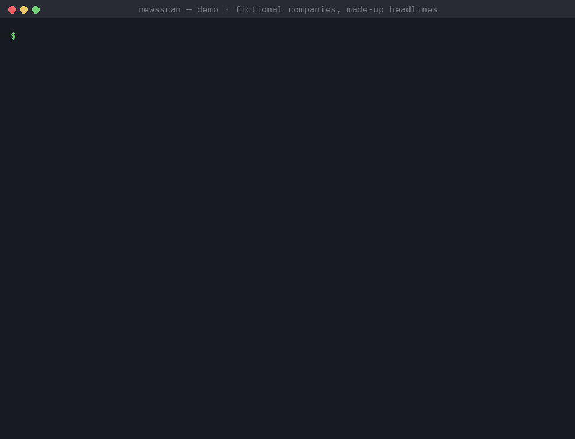

# NewsSentimentScanner

News-driven signals for short-term traders in Indian markets. It pulls the latest headlines
for your watchlist from Google News, scores their sentiment, tags **why** a stock might move
(order wins, broker upgrades, results, SEBI action, pledges…), and tells you **only what changed**
since your last run. A pre-market mode reads overnight global cues (GIFT Nifty, Wall Street,
Asia, FII flows, crude, rupee, US yields) and summarises the news backdrop for the open.



<sub>The animation uses `newsscan demo`: fictional companies and made-up headlines, no real data.</sub>

> **Not investment advice.** Headlines are a noisy, lagging signal. Use this to decide *what to
> look at*, then check price action, volume and the actual filings before trading.

---

## Getting started

### 1. Prerequisites

- **Python 3.10 or newer** and **Git**
- A terminal: **PowerShell** on Windows, **Terminal** on macOS / Linux
- Internet access for real scans (the demo works offline)

Check Python:

```bash
python --version      # on macOS/Linux you may need: python3 --version
```

### 2. Download the project

```bash
git clone https://github.com/RamChetanRCR/Trading.git
cd Trading
```

### 3. Create a virtual environment

This keeps the project's packages separate from the rest of your system.

<table>
<tr><th>Windows (PowerShell)</th><th>macOS / Linux</th></tr>
<tr><td>

```powershell
python -m venv .venv
.venv\Scripts\Activate.ps1
```

If PowerShell blocks the script, run
`Set-ExecutionPolicy -Scope CurrentUser RemoteSigned` once,
or use `.venv\Scripts\activate.bat` from Command Prompt.

</td><td>

```bash
python3 -m venv .venv
source .venv/bin/activate
```

</td></tr>
</table>

Your prompt should now start with `(.venv)`.

### 4. Install

```bash
python -m pip install --upgrade pip
pip install -r requirements.txt
```

Optional — the FinBERT model (≈ 2 GB with PyTorch; downloads the model on first use):

```bash
pip install -r requirements-finbert.txt
```

### 5. Try the demo (offline, 5 seconds)

```bash
python -m newsscan demo
```

You'll see a watchlist scan, the global-cues backdrop, a "next run" showing only what changed,
and a position-size calculation — all on fictional data. If this works, your setup is fine.

### 6. Add your own watchlist

<table>
<tr><th>Windows (PowerShell)</th><th>macOS / Linux</th></tr>
<tr><td>

```powershell
Copy-Item config\watchlist.example.yaml config\watchlist.yaml
```

</td><td>

```bash
cp config/watchlist.example.yaml config/watchlist.yaml
```

</td></tr>
</table>

Open `config/watchlist.yaml` and list your stocks. It is **git-ignored**, so it never gets committed.

```yaml
watchlist:
  - INFY                                    # short form: searches "INFY share"
  - symbol: RELIANCE
    queries: ["Reliance Industries share", "RIL stock"]
    match: ["Reliance", "RIL"]              # optional: drop headlines that don't name the company
```

### 7. Run a real scan

```bash
python -m newsscan scan
```

The first run records what it saw in `data/history.db` (also git-ignored). Every later run
compares against it and lists only **new** information: a signal flipping direction, a score jump,
or a new catalyst — and only if there are headlines you haven't seen before.

---

## Commands

| Command | What it does |
|---|---|
| `newsscan demo` | Offline walkthrough on fictional companies |
| `newsscan scan` | Scan your watchlist → signal, score, confidence, catalysts, top headlines, changes |
| `newsscan cues` | Pre-market: global cues → news backdrop for the Indian open |
| `newsscan query "gold price"` | One-off scan for any search terms |
| `newsscan size` | Risk-based position size from entry, stop and target |

Use `python -m newsscan …`, or run `pip install -e .` once to get a plain `newsscan` command.

```bash
newsscan scan --headlines 5                     # show more headlines per stock
newsscan scan --markdown reports/today.md       # also write a Markdown report (or --json)
newsscan scan --notify                          # push changes to your phone (see below)
newsscan scan --model finbert                   # vader (default) | finbert | ensemble
newsscan query "gold price" "gold forecast" --name GOLD --window 7d

# ₹1L account, risk 1%, long at 500, stop 480, target 560  →  50 shares, max loss ₹1,000, R:R 3.0
newsscan size --capital 100000 --entry 500 --stop 480 --target 560
newsscan size --capital 100000 --entry 500 --stop 520 --target 450 --side short
```

The sizer rejects a stop or target on the wrong side of entry, caps any position at 25% of
capital (`--max-pct`), and warns when reward:risk is below 1.5 or the stop is more than 8% away.

## How a signal is built

1. **Fetch** — Google News RSS per query (last 2 days, India edition), 15 s timeout with retries.
2. **Filter & de-duplicate** — optional `match` names; the same story from five outlets counts once.
3. **Score** — VADER plus a finance lexicon. Plain VADER thinks "shares" is the verb *to share*
   (+1.2) and "Nifty" means *cool*, so every stock headline leaned positive. The lexicon fixes
   those and adds market verbs (*slips, sheds, net sellers…*). FinBERT and an ensemble are optional.
4. **Tag catalysts** — 13 rule-based tags. Only clearly directional ones (order wins, broker
   rating changes, regulatory action, management exits, pledges) nudge the score by ±0.15;
   results, lock-ins, corporate actions, capex, M&A, block deals and IPOs are tagged but neutral.
5. **Weight by recency** — 24 h half-life; undated headlines get almost no weight.
6. **Aggregate** — a score in [-1, 1] and a **confidence** heuristic: recency-weighted agreement ×
   coverage by *distinct publishers*. It is not a probability.
7. **Diff** — compares with the last run and reports flips, jumps ≥ 0.3 and new catalysts, but
   only when there are genuinely new headlines. History older than 90 days is pruned.

**Global cues.** GIFT Nifty, US, Asia and FII flows use headline tone. Crude, the rupee and US
yields use the **direction of the move** instead: "rupee weakens" is bad for India and "crude
falls" is good, which tone alone gets wrong. The result is labelled as a *backdrop* (strongly
positive … strongly negative), not a gap forecast.

## Evaluation

`evals/` holds 110 labelled headlines about fictional companies (positive / negative / neutral
for the stock, plus expected catalyst tags), including tricky ones like "loss narrows",
"cuts debt" and "F&O ban list".

```bash
python evals/run_evals.py                                  # VADER vs VADER + finance lexicon
python evals/run_evals.py --models vader finbert ensemble  # needs requirements-finbert.txt
python evals/run_evals.py --phrasebank                     # independent benchmark (pip install datasets)
```

Current results ([full report](evals/RESULTS.md)):

| Model | Accuracy | Macro-F1 | Pos↔Neg flips |
|---|---:|---:|---:|
| Plain VADER | 56.4% | 0.565 | 13 / 110 |
| VADER + finance lexicon | **78.2%** | **0.782** | 10 / 110 |

Catalyst tagger: precision 0.98, recall 0.91.

The set was written by the same author as the lexicon, so treat it as a regression guard rather
than an unbiased benchmark; Financial PhraseBank (`--phrasebank`) is the independent check.
CI fails if a change pushes these scores below their thresholds (`tests/test_evals.py`).

## Phone alerts (optional)

Credentials come from environment variables only, never from the config file. Alerts report a
channel as sent only if the service confirmed delivery.

| Channel | Variables |
|---|---|
| [ntfy](https://ntfy.sh) (free, easiest) | `NEWSSCAN_NTFY_TOPIC` (+ optional `NEWSSCAN_NTFY_SERVER`, https only) |
| Telegram bot | `NEWSSCAN_TELEGRAM_TOKEN`, `NEWSSCAN_TELEGRAM_CHAT_ID` |

## Run it on a schedule

**macOS / Linux** (`crontab -e`, times in your machine's timezone):

```cron
30 8 * * 1-5        cd ~/Trading && .venv/bin/python -m newsscan cues --notify
45 8 * * 1-5        cd ~/Trading && .venv/bin/python -m newsscan scan --notify
35 10-14/2 * * 1-5  cd ~/Trading && .venv/bin/python -m newsscan scan --notify
```

**Windows** (Task Scheduler → Create Basic Task → Weekly, Mon–Fri):
- Program: `C:\path\to\Trading\.venv\Scripts\python.exe`
- Arguments: `-m newsscan scan --notify`
- Start in: `C:\path\to\Trading`

## Your data stays local

- `config/watchlist.yaml`, `data/`, `reports/`, `.env` and CSV/XLSX files are git-ignored.
- The repo contains only an example watchlist, synthetic test headlines and fictional demo data.
- No broker login, API key or account data is needed or stored.

## Project layout

```
newsscan/
  fetch.py       Google News RSS (timeout + retries), UTC timestamps, de-duplication
  sentiment.py   VADER + finance lexicon, FinBERT (lazy), ensemble
  catalysts.py   rule-based catalyst tags
  scoring.py     recency weighting, aggregation, confidence
  cues.py        global cues: tone vs move-direction, news backdrop
  history.py     SQLite run history, seen headlines, change detection, retention
  sizing.py      risk-based position sizing (long / short)
  config.py      watchlist loading + validation
  notify.py      ntfy / Telegram alerts
  report.py      terminal tables, Markdown, JSON
  demo.py        fictional demo data
  cli.py         command-line entry point
evals/           labelled headlines, eval runner, RESULTS.md
scripts/         make_demo_gif.py (regenerates docs/demo.gif)
tests/           offline tests (no network needed)
```

## Development

```bash
pip install -r requirements-dev.txt
pytest -q                                     # unit tests + eval regression guard
python scripts/make_demo_gif.py               # regenerate the README animation (needs pillow)
```

## Limitations

- Headline-only: no article bodies, no price data. Mixed or sarcastic headlines get misread.
- Rule-based catalysts don't judge materiality (a ₹50 crore order is tagged like a ₹5,000 crore one).
- The cues backdrop is a heuristic from news, not live prices.
- Google News results vary by region and time; compare scores over time, not as absolutes.
